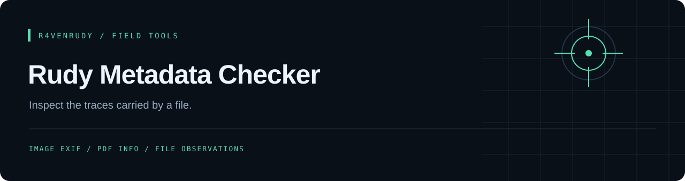

<p align="center"></p>

<p align="center">
  
  
  <a href="LICENSE"></a>
</p>

<p align="center"><strong>Inspect the traces carried by a file.</strong></p>

<p align="center"><a href="#overview">Overview</a> · <a href="#capabilities">Capabilities</a> · <a href="#quick-start">Quick start</a> · <a href="#implementation-notes">Implementation notes</a></p>

---

## Overview

A Discord `/metadata` bot that downloads an attachment, attempts format-specific metadata extraction and returns an embed. It reads EXIF and XMP from JPEG and WebP images, EXIF and XMP from HEIC and AVIF photos, recording date, device and location from MP4/MOV videos, text chunks and EXIF from PNG, comments from GIF, PDF document information and Office (DOCX, XLSX, PPTX) core/app properties.

## Capabilities

| Format | Implemented behavior |
| :--- | :--- |
| JPEG | EXIF camera, model, software, date taken (UTC, falling back to CreateDate), a later modification date, GPS with a map link, altitude and the direction the camera faced, owner name, copyright, camera and lens serials, lens model, image unique ID and an embedded-thumbnail warning, plus XMP title/author/creator tool and GPS, IPTC by-line, city, country, caption and keywords (APP13), and comment (COM) segments |
| GIF | Size, frame count, comment extensions (often a tool or author name), writer extensions and any XMP packet |
| WebP | The same EXIF fields from the RIFF `EXIF` chunk, plus the `XMP ` chunk |
| HEIC / HEIF / AVIF | The same EXIF fields (iPhone photos keep GPS here) from the `Exif` item located via `iinf` / `iloc`, plus any XMP packet |
| MP4 / MOV | Recording date and duration (`mvhd`), device, software and GPS from `udta` (`©xyz`) or the iPhone QuickTime keys; videos must fit the 25 MB limit |
| PNG | tEXt / zTXt / iTXt text chunks (Author, Software, Description, Creation Time…), a summary of embedded XMP, and EXIF (camera, date, GPS) from an `eXIf` chunk |
| PDF | Title, author, subject, keywords, creator, producer, page count, and creation/modification dates formatted from PDF date strings; flags JavaScript, open actions, launch actions and embedded files found in the uncompressed parts of the file, and counts incremental saves (an edited PDF can still contain its earlier text) |
| DOCX / XLSX / PPTX | Title, author, last modified by, revision, created/modified dates, application, company, template, page/word/slide counts and total editing time from `docProps/core.xml` and `app.xml` |
| Discord | `/metadata file:<attachment>` with extracted fields and review labels; the type is detected from the file contents; unsupported or over-25 MB files get a private rejection |

## Quick start

Requires Node.js, a Discord application and the parser dependencies in `package.json`. Keep the bundled `raven.png`; startup checks its file size and image signature.

```bash
git clone https://github.com/r4venrudy/rudy-metadata-checker.git
cd rudy-metadata-checker
npm install
```

Set the `DISCORD_TOKEN` and `CLIENT_ID` environment variables (and optionally `COOLDOWN_SECONDS`, default 10, the wait between one user's files), then start the bot:

```bash
node index.js
```

Invite it with `bot` and `applications.commands` scopes. Use `/metadata` with a file you are permitted to inspect.

## Implementation notes

- The PDF path uses the `pdf-parse` v2 `PDFParse.getInfo()` API and destroys its worker after use. An offline PDF fixture checks document information extraction.
- The attachment is downloaded into memory (no temporary files) with a 15 second timeout; files over 25 MB are rejected before download.
- Values from the file are escaped so Discord markdown in an author name or title cannot restyle the reply.
- Replies are channel-visible and may contain GPS coordinates or author names. A missing EXIF result can mean unsupported parsing or no readable metadata; it does not prove deliberate stripping.
- This documentation is based on source inspection; authenticated Discord and parser integrations require live validation.

## Project map

```text
index.js                 Attachment handling, type detection and Discord command
packaging/image-meta.cjs EXIF fields and sensitive-data labels
packaging/png-meta.cjs   PNG text chunks and XMP summary
packaging/webp-meta.cjs  WebP RIFF chunks (EXIF, XMP)
packaging/heic-meta.cjs  HEIC/HEIF Exif item
packaging/video-meta.cjs MP4/MOV date, device and GPS
packaging/gif-meta.cjs   GIF comments and extensions
packaging/jpeg-extra.cjs JPEG comments and IPTC
packaging/pdf-*.cjs      PDF info and date formatting
packaging/docx-meta.cjs  Office (DOCX/XLSX/PPTX) ZIP reading and XML properties
packaging/*.test.cjs     Tests (npm test)
raven.png                Required startup asset
```

## GitHub package

A non-root container is published to GitHub Packages after build and offline configuration checks. Credentials are supplied at runtime and are excluded from the image.

```sh
cp .env.example .env
# Fill in your own values in .env, keeping that file private.
docker run --rm --env-file .env ghcr.io/r4venrudy/rudy-metadata-checker:latest --check-config
docker run --rm --env-file .env ghcr.io/r4venrudy/rudy-metadata-checker:latest
```

`--check-config` validates installed dependencies, the bundled asset, and required settings without connecting to Discord. `RUDY_CONFIG` optionally points to a mounted JSON configuration file; environment variables take priority.

Only public project files are packaged. Image tags are `latest` and `sha-<full commit SHA>`. Discord login and external API behavior still require your own account configuration; CI never uses live credentials.


## License

[MIT](LICENSE). Preserve the attribution in the license file.

---

<p align="center">Part of the <a href="https://github.com/r4venrudy">r4venrudy</a> project collection.</p>
